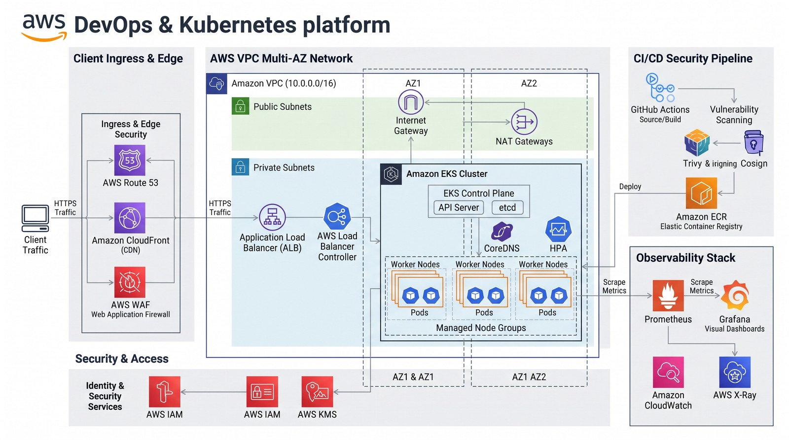

# 🚀 AWS DevOps Platform Engineering Hub

<p align="center">
  
</p>

<div align="center">

[]()
[]()
[]()
[](LICENSE)

</div>

---

## 📌 Overview

**AWS DevOps Platform Engineering Hub** is an enterprise-grade cloud native platform blueprint designed for high availability, zero-trust security boundaries, and automated GitOps continuous delivery.

### Key Capabilities

- **Modular Infrastructure as Code:** AWS VPC Multi-AZ foundation with automated NAT Gateway routing and KMS encryption.
- **GitOps Continuous Deployment:** Argo CD ApplicationSets managing automated multi-cluster application delivery.
- **DevSecOps Built-In:** Trivy static configuration vulnerability scanning and container security validation.
- **High Observability:** Metric instrumentation hooks ready for Prometheus, Grafana, and AWS CloudWatch integration.

---

## 📂 Architecture & Directory Structure

```text
aws-devops-platform-engineering-hub/
├── .github/
│   └── workflows/
│       └── ci.yaml             # Automated Terraform verification & security linting
├── docs/
│   └── images/
│       ├── platform-architecture-white.jpg  # White-theme architecture schematic
│       └── architecture.svg                 # Crisp vector schematic
├── k8s/
│   └── argocd-applicationset.yaml    # Automated GitOps multi-cluster deployment
├── terraform/
│   ├── main.tf                 # VPC, KMS, IAM, and Networking definition
│   └── variables.tf            # Environment and region parameters
├── .gitattributes              # Linguist language accuracy mapping
└── README.md                   # Platform documentation
```

---

## 🛠️ Getting Started

### Prerequisites

- Terraform >= 1.6.0
- AWS CLI v2 configured with appropriate IAM credentials
- Kubectl & Helm 3.x

### Deployment

```bash
# Clone the repository
git clone https://github.com/tayyabmasood911/aws-devops-platform-engineering-hub.git
cd aws-devops-platform-engineering-hub/terraform

# Initialize and validate
terraform init
terraform plan -out=tfplan
terraform apply tfplan
```

---

## 📄 License

This project is licensed under the MIT License.
